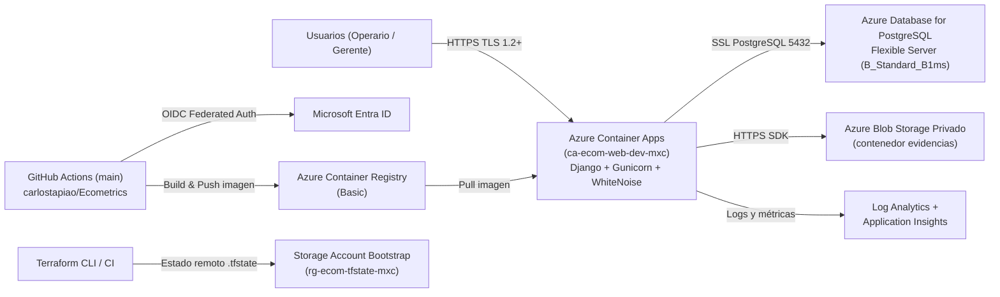

# Plan de Despliegue en Azure y Plan Financiero Inicial (Nivel Intermedio)

Fecha: 2026-11-14  
Estado: Propuesto para revisión y aprobación de implementación.  
Contexto: Fase de preparación y despliegue demostrativo en Microsoft Azure ([SPEC.md](../SPEC.md), [STATE.md](../STATE.md)) + Plan Financiero Inicial bajo la metodología de EFSRT II (TC referencial acordado: **1 USD = S/ 3.50**).

---

## 1. Objetivo y límites

### Objetivo
Desplegar el monolito **EcoMetrics** (Django 5.2 + PostgreSQL 16) en **Microsoft Azure** dentro de la suscripción *Azure for Students* (`94846a8b-9491-4312-82bb-3082c340b45f`) en la región **`mexicocentral`**, automatizando la infraestructura con **Terraform (con bootstrap de estado remoto)** y la entrega continua con **GitHub Actions (OIDC)** desde la rama `main` del repositorio público `carlostapiao/Ecometrics`, acompañado del **Plan Financiero Inicial (Nivel Intermedio)** en USD y Soles.

### Alcance confirmado con Carlos
- **Proveedor y nivel**: Todo en **Microsoft Azure**, arquitectura de **Nivel Intermedio** (sin alta disponibilidad multi-zona ni balanceadores dedicados costosos que excedan los límites de *Azure for Students*).
- **Dominio y HTTPS**: Subdominio HTTPS proporcionado por defecto por Azure Container Apps (`*.mexicocentral.azurecontainerapps.io`). Sin compra de dominio propio.
- **Activación de cuentas**: Se mantiene por **enlace manual** generado por gerencia (sin servidor SMTP ni servicios de correo/SMS externos).
- **Archivos privados (`ECOMETRICS_MEDIA_ROOT`)**: Almacenados en **Azure Blob Storage** privado (equivalente en Azure a S3), sin backups adicionales en la nube.
- **Datos iniciales en la nube**: Carga exclusiva de los **datos de demostración** (`Planta Norte`, `Planta Sur` y las 4 cuentas demo mediante `preparar_demo`).
- **Infraestructura y CI/CD**: **Terraform con bootstrap** (estado remoto en Azure Storage) y despliegue automático por **GitHub Actions** desde la rama `main`.

### Exclusiones
- No se implementa Multi-AZ Failover (*Zone-Redundant HA*), *Application Gateway WAF*, *Azure API Management* ni backups adicionales o geo-redundantes.
- No se migran bases de datos locales con registros previos al entorno cloud; la nube inicia limpia con las migraciones y el seed demo.
- Este documento define el plan; ninguna creación de recursos en Azure ni `git push` hacia GitHub se ejecuta sin la autorización de implementación correspondiente.

---

## 2. Verificación previa del entorno (observado el 2026-11-14)

Comprobaciones de solo lectura ejecutadas en la estación de trabajo de Carlos:
1. **Herramientas locales**:
   - `git`: `2.53.0.windows.2`
   - `terraform`: `v1.14.7` (`windows_amd64`)
   - `az` (Azure CLI): `2.91.0`
   - `gh` (GitHub CLI): `2.94.0`
2. **Suscripción y políticas en Azure**:
   - Suscripción activa: `Azure for Students` (`94846a8b-9491-4312-82bb-3082c340b45f`), Tenant `6418e6e8-7843-4ffb-8c18-154e7f3fedd8`, cuenta `carlostapiaT3csup32@gmail.com`.
   - Política `sys.regionrestriction` (*Allowed resource deployment regions*): restringe despliegues exclusivamente a **`["chilecentral", "mexicocentral", "northcentralus", "canadacentral", "westcentralus"]`**.
   - Disponibilidad en **`mexicocentral`**: confirmada para `Microsoft.App/containerApps` y `Microsoft.DBforPostgreSQL/flexibleServers` (edición `Burstable`).
   - Proveedores en estado `Registered`: `Microsoft.Storage`, `Microsoft.OperationalInsights`, `Microsoft.DBforPostgreSQL`, `Microsoft.ContainerRegistry` y `Microsoft.App`.
3. **Estado de Git y GitHub**:
   - El repositorio local está en la rama `main` con cambios sin confirmar correspondientes al retiro de Conciliación/Salidas y aún sin `remote` configurado.
   - El repositorio remoto creado por Carlos es `https://github.com/carlostapiao/Ecometrics.git` (cuenta `carlostapiao`), mientras que `gh auth status` en la consola tiene un token activo de `carlostapiaorellana`. Durante la implementación se ajustará la autenticación/permisos hacia `carlostapiao/Ecometrics`.

---

## 3. Arquitectura en Azure (Nivel Intermedio)

### Inventario de recursos Azure a aprovisionar

| Capa | Recurso Azure | Nombre CAF propuesto | SKU / Configuración | Propósito y control de costos |
| --- | --- | --- | --- | --- |
| **Bootstrap IaC** | Resource Group + Storage Account | `rg-ecom-tfstate-mxc` / `stecomtfstate<sufijo>` | `Standard_LRS`, TLS 1.2, contenedor `tfstate` | Guardar `terraform.tfstate` de forma segura fuera de Git y compartido con CI/CD. |
| **Grupo principal** | Resource Group | `rg-ecom-dev-mxc` | Región `mexicocentral` | Contenedor lógico de todos los recursos del entorno demostrativo. |
| **Registro Docker** | Azure Container Registry (ACR) | `acrecomdevmxc<sufijo>` | `Basic` | Almacenar las imágenes Docker versionadas por `git sha`. (\$5.00 USD/mes). |
| **Base de datos** | Azure Database for PostgreSQL Flexible Server | `psql-ecom-dev-mxc` | PostgreSQL 16, edición `Burstable`, SKU `B_Standard_B1ms` (1 vCore, 2 GiB RAM), 32 GiB storage, sin backups adicionales ni geo-redundancia, SSL obligatorio | Persistencia relacional transaccional de sedes, usuarios, pesajes e historial. (\$16.00 USD/mes en tarifa estándar). |
| **Archivos privados** | Azure Storage Account (Blob) | `stecommediadevmxc<sufijo>` | `Standard_LRS`, acceso público deshabilitado (`allow_nested_items_to_be_public = false`) | Contenedor privado `evidencias` (`ECOMETRICS_MEDIA_ROOT` en nube). (\$1.00 USD/mes). |
| **Cómputo Web** | Azure Container Apps Environment + App | `cae-ecom-dev-mxc` / `ca-ecom-web-dev-mxc` | Plan *Consumption* (`0.5 vCPU`, `1.0 GiB RAM`, `min_replicas = 1`, `max_replicas = 3`), Ingress HTTPS externo al puerto `8000` | Ejecutar el monolito Django con subdominio HTTPS automático y probes `/healthz` y `/readyz`. (\$8.00 USD/mes en uso estándar; primeros 180k vCPU-s gratis/mes). |
| **Observabilidad** | Log Analytics + Application Insights | `log-ecom-dev-mxc` / `appi-ecom-dev-mxc` | `PerGB2018`, retención 30 días | Registro de contenedores y trazas de errores. (\$0.00 dentro de los primeros 5 GB/mes gratuitos). |
| **Identidad CI/CD** | Entra App + Service Principal + OIDC | `sp-ecom-github-oidc` | Credencial federada para `repo:carlostapiao/Ecometrics:ref:refs/heads/main` | Despliegue desde GitHub Actions sin guardar contraseñas largas de Azure. Sin costo. |

---

## 4. Componentes afectados en el repositorio

### 4.1. Preparación de Django y Docker para producción (conservando compatibilidad local)
1. **[requirements.txt](file:///c:/Carpeta%20de%20Carlos/Cerebro/projects/ecometrics/requirements.txt)**:
   - Agregar versiones fijas compatibles de `gunicorn`, `whitenoise` y `django-storages[azure]`.
2. **[src/configuracion/settings.py](file:///c:/Carpeta%20de%20Carlos/Cerebro/projects/ecometrics/src/configuracion/settings.py)** y **[src/inicio/test_respaldos.py](file:///c:/Carpeta%20de%20Carlos/Cerebro/projects/ecometrics/src/inicio/test_respaldos.py)**:
   - `ALLOWED_HOSTS`: cargar desde variable `DJANGO_ALLOWED_HOSTS` (lista separada por comas, sin comodín `*` para preservar `PaginaInicialTests.test_no_acepta_host_ajeno`), manteniendo `localhost,127.0.0.1,[::1]` por defecto.
   - `CSRF_TRUSTED_ORIGINS`: cargar desde `DJANGO_CSRF_TRUSTED_ORIGINS` (p. ej. `https://*.mexicocentral.azurecontainerapps.io`) para que el envío de formularios funcione bajo HTTPS en Azure.
   - Seguridad detrás de proxy inverso cuando `DEBUG=False`:
     - `SECURE_PROXY_SSL_HEADER = ("HTTP_X_FORWARDED_PROTO", "https")`
     - `SESSION_COOKIE_SECURE = True` y `CSRF_COOKIE_SECURE = True`
   - Archivos estáticos: añadir `whitenoise.middleware.WhiteNoiseMiddleware` después de `SecurityMiddleware` y definir `STATIC_ROOT = Path(os.environ.get("DJANGO_STATIC_ROOT", "/var/lib/ecometrics/staticfiles"))`, fuera de `/app` para que el volumen `- ./src:/app` de `compose.yaml` no oculte los archivos estáticos compilados en la imagen ni ensucie `src/`.
   - Base de datos PostgreSQL: añadir soporte opcional de `sslmode` mediante `POSTGRES_SSLMODE` (`prefer` en local, `require` en Azure).
   - Almacenamiento de archivos privados (`STORAGES`):
     - Si se define `AZURE_STORAGE_CONNECTION_STRING` (en el contenedor de Azure), configurar `STORAGES["default"]` con `storages.backends.azure_storage.AzureStorage` apuntando al contenedor privado `evidencias` (`azure_ssl = True`, `expiration_secs = 3600`), compatible con `comprobar_persistencia.py` (que opera sobre `default_storage`).
     - Si no se define (entorno local Docker Compose y suite de pruebas), mantener `FileSystemStorage` sobre `MEDIA_ROOT` (`/data/evidencias`). En `src/inicio/test_respaldos.py`, asegurar explícitamente `FileSystemStorage` en `override_settings` para que las pruebas locales de `comprobar_respaldo` sean herméticas.
3. **[Dockerfile](file:///c:/Carpeta%20de%20Carlos/Cerebro/projects/ecometrics/Dockerfile)** y **[compose.yaml](file:///c:/Carpeta%20de%20Carlos/Cerebro/projects/ecometrics/compose.yaml)**:
   - En `Dockerfile`: crear `/var/lib/ecometrics/staticfiles` con propietario `appuser:appuser`, ejecutar `DJANGO_SECRET_KEY=build-collectstatic-only-not-for-runtime python manage.py collectstatic --noinput` en una sola instrucción `RUN` (sin persistir `DJANGO_SECRET_KEY` en `ENV`) y usar `gunicorn configuracion.wsgi:application --bind 0.0.0.0:8000 --workers 2 --timeout 60` como comando por defecto.
   - En `compose.yaml`: conservar el funcionamiento local intacto en `http://127.0.0.1:8010/`.
4. **[.gitignore](file:///c:/Carpeta%20de%20Carlos/Cerebro/projects/ecometrics/.gitignore)** y **[.dockerignore](file:///c:/Carpeta%20de%20Carlos/Cerebro/projects/ecometrics/.dockerignore)**:
   - En `.gitignore`: excluir `staticfiles/`, `**/.terraform/*`, `*.tfstate`, `*.tfstate.*`, `*.tfvars`, `!*.tfvars.example`, `crash.log`.
   - En `.dockerignore`: excluir `infra/`, `specs/` y `.github/` para no ensuciar el contexto de compilación de Docker.

### 4.2. Infraestructura como Código (`infra/terraform/`)
Siguiendo la estructura modular validada en tus laboratorios previos:
- `infra/terraform/bootstrap/`:
  - `main.tf`, `variables.tf`, `outputs.tf`, `versions.tf` → aprovisiona `rg-ecom-tfstate-mxc` y el Storage Account con contenedor `tfstate`.
- `infra/terraform/environments/dev/`:
  - `versions.tf`: proveedor `azurerm` y bloque `backend "azurerm"`.
  - `variables.tf`: `location` con `default = "mexicocentral"` y bloque `validation` con las 5 regiones permitidas por *Azure for Students* (`["mexicocentral", "northcentralus", "chilecentral", "canadacentral", "westcentralus"]`).
  - `main.tf`, `outputs.tf`, `terraform.tfvars.example`.
- `infra/terraform/modules/`:
  - `acr/`, `postgres_flexible/`, `storage/`, `observability/`, `container_app/`, `azure_oidc_github/`.

### 4.3. Automatización CI/CD (`.github/workflows/deploy.yml`)
- Eventos: `push` a `main` y `workflow_dispatch`.
- **Etapa 1 — Verificación (`verify`)**:
  - Levanta contenedor de servicio `postgres:16`, instala dependencias y ejecuta **con `working-directory: src`** (necesario porque `src/` no es paquete Python y ejecutar desde la raíz descubriría 0 pruebas) y una `DJANGO_SECRET_KEY` efímera de CI:
    - `python manage.py check`
    - `python manage.py makemigrations --check --dry-run`
    - `python manage.py test --noinput` (ejecutando las 92+ pruebas reales).
- **Etapa 2 — Despliegue (`deploy`, depende de `verify`)**:
  - Login a Azure por OIDC (`azure/login@v2` usando `AZURE_CLIENT_ID`, `AZURE_TENANT_ID`, `AZURE_SUBSCRIPTION_ID`).
  - Construcción y publicación de imagen Docker en ACR etiquetada con `${{ github.sha }}`.
  - Actualización de `ca-ecom-web-dev-mxc` (ejecutando `python manage.py migrate --noinput` antes de iniciar los workers de Gunicorn o en paso dedicado contra `psql-ecom-dev-mxc` con `POSTGRES_SSLMODE=require`) y verificación automática de `/healthz` y `/readyz` (código HTTP `200`).
  - Para la carga única inicial de `preparar_demo` en Azure, se ejecutará `python manage.py preparar_demo` con `working-directory: src` alimentando `.private/accesos-demo-azure.json` por `stdin` hacia `psql-ecom-dev-mxc` (`POSTGRES_SSLMODE=require`) bajo regla de firewall temporal autorizada, evitando depender de tuberías interactivas sobre `az containerapp exec` y sin exponer contraseñas en línea de comandos ni logs.

---

## 5. Plan Financiero Inicial — Nivel Intermedio (Metodología EFSRT II)

Elaborado según las fórmulas de la **Sesión 11 (`Sesion11_final.pptm`)** de EFSRT II, sobre tarifas de una **cuenta estándar comercial de Azure (*Pay-As-You-Go*)** operando 24/7, separando como referencia técnica sin costo para el cliente todo el desarrollo e ingeniería asumidos con conocimientos propios.
- **Tipo de cambio acordado**: `1.00 USD = S/ 3.50`
- **Modelo de monetización**: **Opción A — SaaS B2B para empresas multi-sede** (Opción 1 elegida: suscripción accesible de **\$25.00 USD / `S/ 87.50` al mes por sede**).

### 5.1. Desglose del Costo Técnico Cloud en Azure (Base Fija Mensual — Cuenta Estándar Normal)

| Ítem | Servicio en Azure (`mexicocentral`) | Configuración / SKU | Tarifa Mensual Estándar (USD) | Tarifa Mensual Estándar (PEN - S/ 3.50) | Gasto real en tu demo (~1.5 h encendido) |
| --- | --- | --- | --- | --- | --- |
| 1 | Azure Database for PostgreSQL Flexible Server | `B_Standard_B1ms` (1 vCore, 2 GiB RAM) + 32 GiB Storage, sin backups extra ni geo-redundancia | \$16.00 | S/ 56.00 | ~\$0.05 – \$0.50 |
| 2 | Azure Container Apps | Entorno *Consumption* (`0.5 vCPU`, `1 GiB RAM`) + HTTPS incluido | \$8.00 | S/ 28.00 | \$0.00 *(capa gratuita)* |
| 3 | Azure Container Registry (ACR) | SKU `Basic` (almacenamiento de imágenes Docker) | \$5.00 | S/ 17.50 | ~\$0.17 por día activo |
| 4 | Azure Blob Storage (Equivalente S3) | `Standard_LRS` (contenedores privados `evidencias` y `tfstate`, sin backups extra) | \$1.00 | S/ 3.50 | < \$0.05 |
| 5 | Log Analytics + Application Insights | Telemetría y logs base (primeros 5 GB/mes gratuitos en cuenta estándar) | \$0.00 | S/ 0.00 | \$0.00 |
| **Total** | **Infraestructura Cloud Fija Base** | **Cuenta comercial estándar (24/7)** | **\$30.00 USD** | **S/ 105.00** | **~ \$1.00 – \$2.00 USD en total** *(de tu crédito estudiantil)* |

> [!NOTE]
> En *Azure Database for PostgreSQL Flexible Server*, la plataforma mantiene el mínimo técnico de 7 días de retención sin costo adicional (`$0.00`) dentro de los 32 GiB aprovisionados; no se contratan backups adicionales ni redundancia geográfica. Para tus pruebas (1 h) y presentación (0.5 h), el consumo total descontado de tu crédito *Azure for Students* será de ~\$1.00 a \$2.00 USD (`S/ 0.00` de desembolso).

---

### 5.2. Inversión Inicial del Proyecto TI (CAPEX — Slide 5) y Referencia Técnica Incluida

#### A) CAPEX cobrable / desembolsable para puesta en marcha
| Concepto CAPEX | Descripción | Monto (USD) | Monto (PEN - S/ 3.50) |
| --- | --- | --- | --- |
| 1. Puesta en marcha e inicialización Cloud | Aprovisionamiento inicial del entorno en Azure, configuración de seguridad/variables y carga inicial de sedes | \$40.00 | S/ 140.00 |
| **Total CAPEX** | **Inversión Inicial Total de puesta en marcha** | **\$40.00 USD** | **S/ 140.00** |

#### B) Componentes técnicos incluidos en la plataforma (Referencia asumida por conocimientos propios — \$0.00 cobrado a la empresa)
Los siguientes componentes forman parte del valor técnico entregado por EcoMetrics, pero **son asumidos íntegramente por el conocimiento e infraestructura propia del equipo** y no se trasladan como sobrecosto a la empresa cliente:
- **Adecuación Cloud del Software** *(valor referencial de mercado: \$280.00 / S/ 980.00)*: empaquetado WSGI con Gunicorn y WhiteNoise, protección HTTPS/CSRF e integración con Azure Blob Storage.
- **Ingeniería IaC y Automatización CI/CD** *(valor referencial: \$120.00 / S/ 420.00)*: módulos Terraform con bootstrap remoto y pipeline automatizado en GitHub Actions con autenticación federada OIDC.
- **Aseguramiento de Calidad (QA) y Documentación** *(valor referencial: \$80.00 / S/ 280.00)*: batería de 92+ pruebas automatizadas contra PostgreSQL y guías operativas por rol (Operario / Gerente).
- **Equipos de cómputo, herramientas de desarrollo y gestión inicial** *(valor referencial: \$40.00+ / S/ 140.00+)*: aportados por los integrantes del equipo sin cargo al cliente.

---

### 5.3. Gastos Operativos Mensuales (OPEX): Costos Fijos y Costos Variables (Slides 12 a 17)

#### A) Costos Fijos Mensuales de TI (`CFT`) — *Independientes del número de clientes/sedes*
El costo de mantenimiento mensual se mantiene moderado y por debajo del costo fijo mensual de Azure:

| Concepto de Costo Fijo | Clasificación (Slide 13) | Costo Mensual (USD) | Costo Mensual (PEN - S/ 3.50) |
| --- | --- | --- | --- |
| 1. Infraestructura Cloud Fija Base en Azure (cuenta estándar 24/7) | Comprometido | \$30.00 | S/ 105.00 |
| 2. Mantenimiento técnico preventivo y monitoreo mensual (parches, revisión de logs y actualizaciones menores) | Comprometido | \$15.00 | S/ 52.50 |
| **Costo Fijo Total Mensual de TI (`CFT`)** | **Suma de gastos fijos mensuales** | **\$45.00 USD** | **S/ 157.50** |

Aplicando las **3 fórmulas de Costo Fijo del profesor (Slide 14)**:
1. **Costo Fijo Total Mensual (`CFT`)**:
   $$\text{CFT} = 30.00 + 15.00 = \mathbf{\$45.00\text{ USD/mes}} \quad (\mathbf{\text{S/ } 157.50\text{/mes}})$$
2. **Costo Fijo Anual de TI**:
   $$\text{Costo Fijo Anual} = \text{CFT} \times 12 = \$45.00 \times 12 = \mathbf{\$540.00\text{ USD/año}} \quad (\mathbf{\text{S/ } 1,890.00\text{/año}})$$
3. **Costo Fijo Medio por Usuario (`CFMe`)** *(estimando una base operativa de **50 usuarios activos** entre operarios y gerentes)*:
   $$\text{CFMe} = \frac{\text{CFT}}{\text{N.º de usuarios}} = \frac{\$45.00}{50} = \mathbf{\$0.90\text{ USD por usuario/mes}} \quad (\mathbf{\text{S/ } 3.15\text{ por usuario/mes}})$$

---

#### B) Costos Variables por Sede / Cliente Activo (`CVu`) — *Cambian según el volumen de sedes (Slides 15 a 17)*

Unidad de medida comercial: **1 Sede/Planta monitoreada activa al mes**.

| Componente Variable por Sede | Descripción | Costo Unitario (USD) | Costo Unitario (PEN - S/ 3.50) |
| --- | --- | --- | --- |
| 1. Consumo incremental en Azure | Cómputo elástico, almacenamiento en BD/Blob y transferencia por pesajes y reportes CSV/HTML de la sede | \$3.00 | S/ 10.50 |
| 2. Soporte operativo puntual por sede | Atención de consultas operativas y gestión/reemisión de enlaces de activación | \$2.00 | S/ 7.00 |
| **Costo Variable Unitario (`CVu`)** | **Costo directo adicional por cada sede activa al mes** | **\$5.00 USD** | **S/ 17.50** |

Aplicando la **fórmula de Costo Variable Total (`CVT = CVu × Unidades`) de la Slide 17**:
- **Escenario Inicial (Empresa piloto con 2 sedes: Planta Norte y Planta Sur)**:
  $$\text{CVT}_{2\text{ sedes}} = \$5.00 \times 2 = \mathbf{\$10.00\text{ USD/mes}} \quad (\mathbf{\text{S/ } 35.00\text{/mes}})$$
- **Escenario Crecimiento A (5 sedes activas)**:
  $$\text{CVT}_{5\text{ sedes}} = \$5.00 \times 5 = \mathbf{\$25.00\text{ USD/mes}} \quad (\mathbf{\text{S/ } 87.50\text{/mes}})$$
- **Escenario Crecimiento B (10 sedes activas)**:
  $$\text{CVT}_{10\text{ sedes}} = \$5.00 \times 10 = \mathbf{\$50.00\text{ USD/mes}} \quad (\mathbf{\text{S/ } 175.00\text{/mes}})$$

---

### 5.4. Propuesta Comercial, Margen de Contribución y Punto de Equilibrio (Slides 18 a 21)

#### Tarifas de venta al cliente empresarial (Opción 1 — Accesible PYME)
1. **Setup / Activación Inicial (Pago único por empresa nueva)**: **\$50.00 USD (`S/ 175.00`)**
   - Cubre la configuración de sus sedes iniciales, creación de cuentas gerenciales/operarias e inducción.
2. **Suscripción Mensual SaaS (`P` — Precio de Venta Unitario por sede)**: **\$25.00 USD / mes por sede (`S/ 87.50 / mes por sede`)**
   - Para una empresa con **2 sedes** (como el caso demostrativo `Planta Norte` + `Planta Sur`), el cobro mensual total es de **\$50.00 USD (`S/ 175.00 / mes`)**.

#### Cálculo paso a paso del Punto de Equilibrio (fórmulas de las Slides 20 y 21)

1. **Margen de Contribución Unitario (`MCu`) por sede**:
   $$\text{MCu} = \text{Precio de Venta } (P) - \text{Costo Variable Unitario } (\text{CVu})$$
   $$\text{MCu} = \$25.00 - \$5.00 = \mathbf{\$20.00\text{ USD por sede/mes}} \quad (\mathbf{\text{S/ } 70.00\text{ por sede/mes}})$$
   *Interpretación*: De cada **\$25.00 USD (`S/ 87.50`)** que paga una sede al mes, **\$5.00 USD (`S/ 17.50`)** cubren su consumo directo y quedan libres **\$20.00 USD (`S/ 70.00`)** (**80.0% de margen de contribución**) para cubrir los costos fijos de Azure + mantenimiento y generar ganancia.

2. **Punto de Equilibrio en Unidades (`PE_unidades` — Sedes activas)**:
   $$\text{PE}_{\text{unidades}} = \frac{\text{Costos Fijos Totales (CFT)}}{\text{Margen de Contribución Unitario (MCu)}} = \frac{\$45.00}{\$20.00} = \mathbf{2.25\text{ sedes}} \approx \mathbf{3\text{ sedes activas}}$$
   *Interpretación*: EcoMetrics necesita mantener únicamente **3 sedes activas** al mes para cubrir el 100% de sus costos fijos (Azure + mantenimiento) y variables. A partir de la **3.ª sede** el servicio ya genera utilidad neta, y cada sede adicional (4.ª en adelante) deja **\$20.00 USD (`S/ 70.00`)** de ganancia neta mensual.

3. **Punto de Equilibrio en Dinero (`PE_dinero` — Facturación mensual)**:
   - Exacto matemático ($2.25 \times \$25.00$): **\$56.25 USD / mes (`S/ 196.88 / mes`)**.
   - Comercial en unidades enteras ($3\text{ sedes} \times \$25.00$): **\$75.00 USD / mes (`S/ 262.50 / mes`)**, donde el costo total mensual es $\$45.00 + (3 \times \$5.00) = \$60.00\text{ USD}$ (`S/ 210.00`) y queda ya una ganancia neta de **\$15.00 USD / mes (`S/ 52.50 / mes`)**.

4. **Recuperación de la Inversión Inicial (`CAPEX = $40.00 USD / S/ 140.00`)**:
   - Con el primer pago único de Setup de **1 sola empresa cliente** (**\$50.00 USD / `S/ 175.00`**), se recupera el **100% del CAPEX inicial de puesta en marcha (`$40.00 USD / S/ 140.00`) desde el Mes 1**.

---

## 6. Continuidad de datos y gestión de riesgos en la nube

1. **Principio "el software es el envoltorio"**:
   - Los datos de negocio residen en PostgreSQL 16 (esquema documentado con claves foráneas `PROTECT` y tablas de auditoría `EventoPesaje`, `EventoGestion`, `EventoRetiro`) y pueden exportarse en todo momento desde la interfaz gerencial en **CSV UTF-8** o mediante volcado lógico de base de datos.
2. **Almacenamiento y persistencia sin sobrecosto de backups**:
   - **En Azure**: No se contratan backups adicionales ni almacenamiento geo-redundante; `comprobar_persistencia.py` verifica lectura/escritura sobre `default_storage` (`AzureStorage` en el contenedor privado `evidencias`).
   - **En entorno local (`scripts/respaldo-local.ps1` y `comprobar_respaldo.py`)**: se mantiene sin cambios para Docker Compose local sobre `FileSystemStorage` (`MEDIA_ROOT`), sin mezclar rutas locales con el contenedor de blobs remoto.
3. **Riesgos principales y plan de contingencia**:
   - **Riesgo 1: Bloqueo de cuota o capacidad regional en *Azure for Students***.
     - *Mitigación*: Se verificó previamente que `mexicocentral` está permitida por `sys.regionrestriction` y tiene registrados los proveedores. Si el SKU `B_Standard_B1ms` presentara saturación puntual en `mexicocentral` durante `terraform apply`, la variable `location` admite conmutar limpiamente a `northcentralus` o `chilecentral` (ambas autorizadas en tu suscripción).
   - **Riesgo 2: Exposición accidental de secretos en repositorio público (`carlostapiao/Ecometrics`)**.
     - *Mitigación*: Validación estricta de `.gitignore` y `git status --ignored` antes del primer `git commit` / `git push`; `terraform.tfstate` vive exclusivamente en el Storage Account de bootstrap (`rg-ecom-tfstate-mxc`) y las credenciales de despliegue usan OIDC sin secretos estáticos de Azure.
   - **Riesgo 3: Consumo innecesario del crédito de \$100 USD fuera de las ~1.5 horas de pruebas y presentación**.
     - *Mitigación*: Mantener encendidos los recursos únicamente durante la ventana de pruebas (~1 hora) y la presentación (~30 minutos), deteniendo `psql-ecom-dev-mxc` (`az postgres flexible-server stop`) y escalando `ca-ecom-web-dev-mxc` a `0` réplicas (o ejecutando `terraform destroy` al finalizar la exposición).

---

## 7. Secuencia de implementación y criterios de aceptación (cuando autorices ejecutar)

### Fases de ejecución
1. **Fase 1 — Adecuación de Django y Docker**: actualizar `requirements.txt`, `settings.py`, `Dockerfile`, `.gitignore` y `.dockerignore`; ejecutar `.\scripts\verificar.ps1` localmente para confirmar que las **92+ pruebas** siguen aprobadas y el contenedor arranca con **Gunicorn + WhiteNoise**.
2. **Fase 2 — Módulos Terraform y Bootstrap**: crear `infra/terraform/bootstrap` e `infra/terraform/environments/dev` con sus módulos; validar con `terraform fmt -check` y `terraform validate`.
3. **Fase 3 — Aprovisionamiento en Azure (`mexicocentral`)**: aplicar `bootstrap`, inicializar el backend remoto y aplicar `environments/dev` creando ACR, PostgreSQL Flexible Server, Storage Account, Log Analytics/App Insights, Container Apps y OIDC para GitHub.
4. **Fase 4 — Pipeline GitHub Actions y Despliegue**: configurar el remoto `https://github.com/carlostapiao/Ecometrics.git`, verificar que ningún archivo sensible entre al índice Git, subir la rama `main` (con autorización explícita de `git push`), ejecutar el workflow CI/CD y cargar los datos demo (`preparar_demo`) en Azure.
5. **Fase 5 — Verificación extremo a extremo**: comprobar `/healthz` y `/readyz` en la URL HTTPS pública, inicio de sesión de operario y gerente demo, registro de pesaje con coma decimal, exportación CSV/HTML y persistencia en PostgreSQL y Blob Storage.

### Criterios de aceptación observables
- [ ] `.\scripts\verificar.ps1` local pasa todas las pruebas automatizadas con Gunicorn, WhiteNoise y soporte de configuración cloud.
- [ ] `terraform validate` y `terraform plan` en `bootstrap` y `environments/dev` finalizan sin errores en `mexicocentral`.
- [ ] La URL pública HTTPS (`https://ca-ecom-web-dev-mxc...mexicocentral.azurecontainerapps.io`) responde `200 OK` en `/healthz` y `/readyz` con certificado TLS válido.
- [ ] El repositorio público `carlostapiao/Ecometrics` ejecuta el workflow de GitHub Actions en `main` sin exponer `.env`, `.private/` ni `*.tfstate`.
- [ ] Las 4 cuentas demo (`operario_norte`, `operario_norte_2`, `operario_sur`, `gerente_demo`) y las 2 sedes (`Planta Norte`, `Planta Sur`) funcionan en Azure con las mismas reglas de permisos y trazabilidad verificadas en local.
